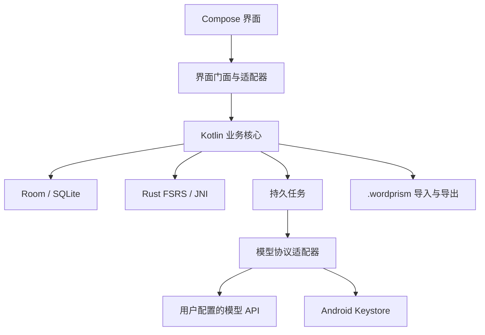

# 架构

WordPrism 是本地优先的 Android 应用。Compose 界面通过 Kotlin SDK 访问业务核心；Room 保存词库与学习记录，Rust FSRS 执行调度和参数拟合，模型请求由手机直接发往用户配置的 API。

## 模块

| 目录 | 职责 |
| --- | --- |
| `android/app` | Compose 页面、导航、输入与 Android 文件选择 |
| `android/sdk-contract` | 供页面使用的挂起方法、状态类型与 Flow |
| `android/sdk-codex` | 将界面门面映射到正式核心契约 |
| `android/sdk-mock` | Debug 开发替身 |
| `backend/core-contract` | 稳定实体、命令、查询、结果与错误类型 |
| `backend/core-engine` | 词库、会话、计划、任务、分析、撤销与包格式 |
| `backend/platform-android` | Room、Keystore、联网监听和 WorkManager |
| `backend/platform-jvm` | 宿主 SQLite 实现与集成测试 |
| `backend/memory-core`、`memory-native` | Kotlin 算法接口与 Rust JNI 内核 |
| `backend/contract-fixtures` | 从契约生成 schema、样例与参考包 |

两个 Gradle 工程通过 `backend/build/repository` 的 Maven 构件衔接，各自保留工具链版本。应用的 `SdkProvider` 打开进程级 `AndroidWordPrism`，页面使用 `WordPrismSdk`；判分、调度、统计和持久化集中在核心。具体调用见[契约](backend/contract.md)与[门面映射](frontend/sdk-mapping.md)。

## 状态与任务

命令带客户端请求键，编辑同时带实体版本。作答、调度与进度在同一业务操作中保存；重复提交返回已有结果。`observe()` 发布持久修订号，订阅者据此重新查询所需视图。

AI 操作保存任务身份、尝试、预设版本和用量。WorkManager 负责唤醒，核心检查任务是否仍可执行和提交；取消、重试及迟到结果使用同一套状态规则。撤销通过补偿操作恢复内容或策略，保留后续学习历史。

Android 存储按 SQLite revision 复用快照，事务只写变化记录；外部写入或冷启动会重新加载。拟合和模型请求在后台执行。

## 离线能力

已保存词库、学习、调度、总览和文件导入导出可在本机完成。新的 AI 添加、讲解、练习和表达反馈等待联网；已有内容仍可使用。后台执行时机由 Android 调度。

详细规则见[产品设计](design/README.md)，环境要求见[构建说明](backend/running.md)。
