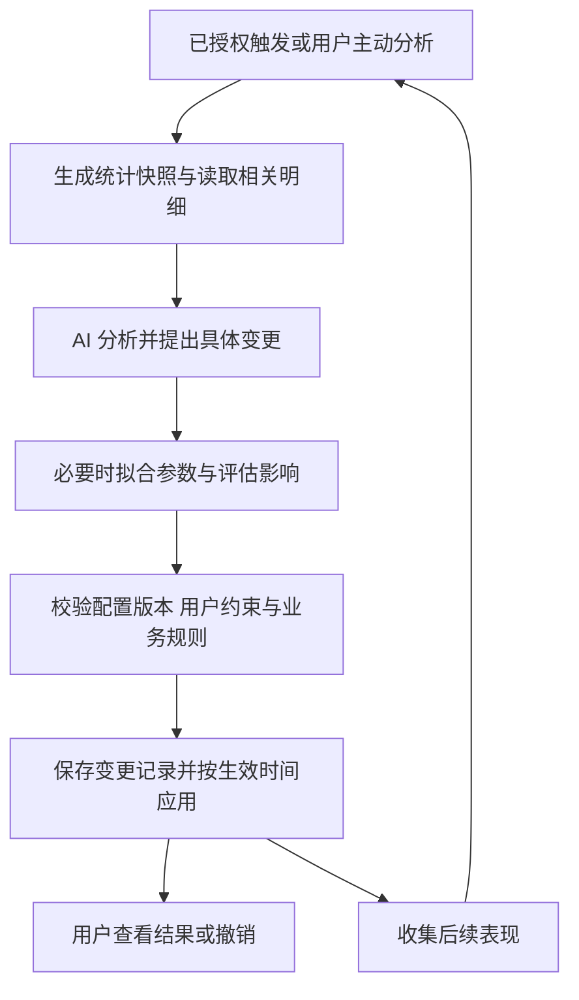

# 学习总览与 AI 自动调整

版本：`v0.4` · 日期：2026-11-03 · 状态：质量目标、时间预算、每日触发和本机运行已确认，具体执行规则为方案

用户要求一份既供自己浏览、又供 AI 分析的使用总结，并让 AI 拥有软件最高权限，能够自动调整学习安排和记忆算法参数。本文维护数据口径、调整权限、生效与回退规则；暂称“学习总览”和“AI 自动调整”，最终名称与前端呈现由 Claude 设计。

## 产品目标

通用算法作为个人数据不足时的起点。系统持续保存实际表现，AI 据此调整明天学多少、重点学哪些、怎样练习，以及适用的调度参数；之后继续观察效果。

AI 的结果包含可执行的变更，开启自动调整后由后端实际应用。每次变化都能查看依据、修改前后值和生效时间，并可以撤销。算法和 AI 的效果均以实际数据检验，不预设其中任何一方一定最优。

## 个人目标与动态预算

用户已确认：每天大致愿意投入半小时以内，AI 优先提高记忆质量，愿意配合有效的记忆训练；具体学习量和时长根据实际表现动态调整。

建议将初始日预算设为 30 分钟，作为计划安排的参考上限。AI 在这个预算内决定当天学多少、练多久，可以提前结束；预算调整由用户决定。接近预算时完成当前题后提供结束或主动继续的选择，不强制中断作答，也不默认把计划延长到预算以外。

| 依据 | 质量优先的调整方向 |
| --- | --- |
| 到期复习或反复混淆较多 | 优先处理相应目标，减少新学量，必要时当天不加新词 |
| 选择题较好，但无提示回忆或新语境表现弱 | 增加适量主动回忆、短文或造句，减少仅重复固定题面的练习 |
| 当前任务需要更长时间才能理解 | 降低任务数量，保留理解、反馈和必要练习的时间 |
| 延迟后表现稳定、任务已完成 | 允许缩短当日学习，或在剩余预算内适量新学 |
| 用户反馈负担大，或实际时间持续超出估计 | 下调后续数量、拆成较短轮次，并更新耗时估计 |
| 本日预算不足以覆盖全部到期项目 | 明确保留未完成项，优先安排必要复习；不把未做内容标为已掌握 |

质量主要观察间隔后的无提示回忆、新语境辨析、实际用词和混淆减少。各能力分开统计，不通过降低题目难度、反复展示答案或无限提高目标保持率来制造高分。

一天可以分多次学习，预算按当日累计。有效学习时间包括讲解与反馈阅读、答题、短文和造句；生成等待、后台停留等单列。阅读时没有点击不直接视为离开，计时依据需要与真实会话状态对应。

每天的具体词数、题型比例和计划时长不固定。后端记录当时的预算、预测耗时、实际耗时及策略版本；数据不足时使用明确标注的初始估计，之后按个人记录调整。所有规则以实际表现检验，不承诺每天必须达到某个词数。

## 同一份事实供用户和 AI 使用

后端从学习事件、配置和任务记录计算结构化快照，前端将它呈现为用户可浏览的信息；AI 读取同一快照，并可按需查询有关明细。用户看到的统计与 AI 收到的统计使用同一口径。

| 数据范围 | 应提供的信息 | 需要保留的上下文 |
| --- | --- | --- |
| 词库积累 | 词条、义项、组数量，新增、归组、推荐采纳与撤销 | 一个词进入多个组不重复计为多个新词 |
| 学习投入 | 活跃学习日、实际作答量、新学量、有效学习时长、完成与中断 | 作答、独立目标和单词数分别计算；等待生成及切后台时间单列 |
| 记忆表现 | 无提示成功、遗忘、困难但答对、使用提示、延迟后表现 | 带机会数和时间窗口，区分观察值与算法预测 |
| 易混关系 | `A → B` 的次数、对应测试机会、近期变化、反复出错的义项 | 方向、题型、义项和内容版本；样本少时直接说明 |
| 能力差异 | 辨认、无选项回忆、拼写、阅读理解、主动表达的表现 | 客观判分、用户反馈与 AI 评价分别标注 |
| 训练与负担 | 到期量、积压、实际完成时间、跳过、用户对难度和负担的反馈 | 计划与实际分开；未来工作量为估计，附模型与假设 |
| AI 内容质量 | 归组纠正、题目争议、反馈纠正、重复题、生成失败 | 未被纠正不等于已经验证正确 |
| API 使用 | 按功能、预设和时间窗口统计请求、已知 token、等待与费用估计 | 缺失用量或价目显示未知；失败和重试也可能有用量 |
| 自动调整历史 | 何时依据哪些数据改了什么、是否生效、是否撤销、后续观察 | 每次调整有配置版本、数据截止时间和可追溯记录 |

快照至少包含 `snapshot_id`、`schema_version`、`as_of`、时间窗口、用户时区、统计口径版本与数据覆盖范围。近期和长期表现可以同时提供，不把一个总分当作全部学习情况。

基础统计可以直接计算与浏览，不需要调用 LLM。AI 写出的解释单独标记为分析结果，附所用快照。数据更新后保留旧分析的截止时间，防止将过期分析显示成实时结论。

AI 可读取稳定 ID 对应的作答、相关题目、用户备注与变更明细。发送给模型的范围按分析需要组织，避免每次重复发送全库。导入文本、题目和笔记作为分析材料，与用户指令、可调用能力定义分开。

## 最高权限如何落到业务能力

按用户要求，分析 AI 拥有应用业务层的最高调整权限。后端提供完整、可发现的参数和动作目录，使新功能加入后也能被 AI 理解和调整。

| 调整范围 | 可以实际执行的动作 |
| --- | --- |
| 学习数量与时间安排 | 在用户日预算内修改明日新学量、复习量目标、计划时长、每轮长度、积压处理与休息安排 |
| 学哪些内容 | 调整目标词、义项和混淆关系的优先级，指定重点，暂停或恢复学习项目 |
| 怎样训练 | 调整混合训练比例、提示策略、背景词难度、短文长度、输出频率和已见内容复用策略 |
| 调度策略 | 调整目标保持率、适用的间隔设置、短期练习策略与调度作用范围 |
| 算法个性化 | 触发个人数据拟合、评估并应用候选参数，选择已实现且兼容的调度策略版本 |
| 资料维护 | 通过现有业务操作纠正分组或内容状态、标记争议题、安排补充训练；保留操作记录 |
| API 与生成策略 | 根据学习证据安排补充练习并使用适用预设；实际调用遵循[API 调用规则](api-presets.md#调用由用户控制) |
| 以后新增的功能 | 使用该功能注册的配置项和动作，读取其含义、约束、影响与回退方式 |

每项可配置能力登记稳定标识、说明、类型、当前值、有效范围、依赖、版本、是否影响调度以及回退方式。AI 可枚举这些能力，再提交结构化变更；后端统一执行与记录，前端无需复制控制逻辑。

这里的最高权限落实为全部已实现业务能力，不需要操作系统权限、直接改源代码或绕开数据库一致性。算法实现的新版本仍需由开发提供；AI 可以调整已暴露的策略、参数，并提出尚缺的能力。

用户明确要求保留最高优先级：例如额外推荐词必须点击加入、用户选择是否调用 API，不能被自动调整改成相反行为。建议同时支持用户锁定某些偏好；AI 可在其余范围内自主调整，无需逐项审批。

真实作答、实际时间、API 用量等历史事实保留原始记录。AI 可以标记异常、改变未来规则或触发重新计算，但不能通过改写过去答案来制造更高正确率。

## 算法微调的执行方式

FSRS 仍为候选基础调度器。其优化器已经能够从个人复习记录拟合参数；期望保持率与数值权重属于不同设置，改变参数和重算到期日期也有不同影响。来源见[个性化补充调研](../research/personalization-and-evolution.md)。

建议把可调整内容分成三类，全部由同一后端策略入口管理：

1. **训练与计划策略**：AI 可依据实际负担和混淆，直接选择明日新学量、目标和题型组合，应用到下一份学习计划。
2. **可解释的调度设置**：AI 可调整目标保持率、适用间隔等设置；保存旧值，计算预计影响，并说明何时生效。
3. **算法内部参数**：AI 可发起优化器拟合，也可提交符合所选算法定义的候选参数。后端校验数值与版本，并使用真实历史评估候选，再决定是否应用。实现中支持数据拟合这一路径，不把生成一串数字当成已经完成个性化训练。

参数候选与当前参数在相同数据和口径下比较。条件允许时使用按时间划分的训练与后续验证数据，历史回放只能利用当时已知的信息。比较指标包括预测误差、估计工作量和实际延迟表现；历史拟合更好并不保证未来收益。

数据不足时仍可根据用户目标、完成情况和明确错误调整学习计划，但算法数值的结论应标明依据不足。所选实现决定哪些参数在当前数据量下可拟合，本轮不照搬旧教程的固定样本门槛。

调度结果由一个版本化的引擎生成。AI 如需提前练习、推迟或集中训练，应通过明确的计划或调度操作实现，保存理由和状态变化，避免在引擎之外直接改一个到期时间。

运行位置现已确定：调度、历史回放、参数拟合和候选评估在手机本机完成；需要 LLM 的分析由手机直连所选 API。算法实现必须覆盖本机调度与优化能力，具体候选和验证顺序见[实施方案](implementation-plan.md#算法内核的选型条件)。

## 一次自动调整

每次变更记录包含 `change_set_id`、关联的 `operation_id`、所用快照、目标配置版本、简短依据、前后值、适用范围、生效时间、算法与预设版本、预计影响、实际状态。执行、取消和撤销复用现有业务操作体系。AI 的简短依据应引用真实数据，不需要保存或展示模型的内部推理过程。

“保持当前设置”也是合法结果，不要求每次分析都改参数。相同快照和配置避免重复调用，数值优化与频繁的小幅计划调整可有不同的触发频率，避免反复来回改动。

用户启用自动模式后，符合约定范围的变更校验通过即执行，不设置逐项人工审批。配置冲突、无效参数或任务失败时保留当前有效设置，返回实际状态；必要的重新分析受调用预算约束。

### 生效时间与撤销

- 进行中的一道题和已开始的学习会话保留其版本，避免答案或评分规则中途变化。新训练策略优先用于下一会话，明日计划用于相应学习日。
- 修改算法参数时，明确选择后续复习逐步使用新设置，还是重算指定范围的未来安排。重算记录为配置或调度事件，不冒充一次用户复习。
- 调整后尚无新学习时，可以恢复原配置与相关计划；已有新作答时，恢复旧策略并基于包含新作答的真实历史重新计算适用状态，保留全部实际进度。
- 撤销记录自身有身份和结果，不删除原分析。后续用户修改过同一参数时，按版本处理冲突，避免旧撤销覆盖较新的明确决定。
- 可撤销最近变更或恢复到所选有效策略版本，真实学习记录继续保留。自动模式的关闭与迟到结果按下方控制规则处理。

## 每日分析与手动控制

用户已确认：每天学习结束后自动分析一次，保留手动触发和关闭选项。以下规定业务事件与执行结果，按钮名称和呈现方式由 Claude 决定。

### 何时触发

- 当日计划完成，或用户明确结束当日学习时，后端记录学习日结束事件，再请求一次自动分析。
- 完成一个小节、暂停、切后台、关闭页面或重新打开应用不单独触发分析；当日可以包含多次学习会话。
- 没有尚未被有效分析覆盖的新增学习数据时，不发起新的自动分析。新增数据相对最近一次有效分析已覆盖的学习记录判断；仅改变配置或分析自身应用了新参数，不算新的学习证据。已经自动分析过后继续学习，不自动追加第二次；用户可以手动分析，或纳入下一次自动分析。
- 使用持久化的 `learning_day_id` 和自动任务记录去重。学习日按有效的本地日期与时区规则确定，时区变更不能重置已经使用的自动执行名额。
- 默认模式为每日学习结束后分析；执行需要用户配置好对应 API 并启用此功能。无需对每天的分析和有效参数调整再次审批。

### 一次执行、手动操作与关闭

“每天一次”指一次自动分析逻辑任务及其有效变更，不是每次进入总结页面就调用。有限重试仍属于同一任务，但实际请求次数和用量分别记录，规则由 [API 方案](api-presets.md#调用由用户控制)维护。

| 情况 | 执行规则 |
| --- | --- |
| 当日结束事件重复送达、应用重启或系统重建任务 | 返回同一自动任务及结果，避免重复请求和重复应用 |
| 手动与自动分析使用相同快照和配置 | 合并到已有任务或复用结果；用户明确要求重新分析时才发起新的手动请求 |
| 用户在自动分析前手动分析过较早的数据 | 当日结束后有新数据，仍可执行当天的一次自动分析 |
| 用户在自动分析后手动触发 | 允许主动分析新数据或明确重新分析，单独记为手动请求，不重置自动次数 |
| 关闭自动分析 | 取消排队任务，尝试取消运行中的请求；保存结果前再次检查开关和配置版本，迟到结果不自动改参数 |
| 关闭前已有变更生效 | 保留当前有效设置与记录，用户可另行撤销；关闭不会丢掉学习进度 |
| 自动模式关闭但用户主动分析 | 手动入口仍可使用，由这次操作发起相应 API 请求 |

### 离线、延迟与失效

统计更新、学习与本地调度不等待 LLM。断网时自动分析保存为待执行，继续使用最近有效策略；恢复联网后由手机重新检查配置、调用额度和数据快照。

跨日积累的旧任务只保留最近需要处理的一份，其余标为已合并，使用最新数据分析，不逐日补发多笔过时请求。延迟执行也占用实际执行日的自动名额；当日不会因旧任务补跑再额外启动第二次自动分析。原始触发日和实际执行日分别保存。

过期分析不能修改已经完成或正在进行的学习。执行前更新快照，应用前核对配置版本，并将调整用于尚未开始的适用计划。没有有效预设、预算用完、请求失败或候选参数无效时，保留现有策略并展示真实状态。

Android 后台运行受系统约束，因此每天学习结束会产生任务，但无法保证断网、系统限制或应用未运行时仍立即完成。详细平台执行方式见[本机实施方案](implementation-plan.md#本地任务与一致性)。

自动分析使用 `learning_analysis` 的 API 预设。查看总览、打开页面或显示既有分析本身不发起新请求；关闭、取消、重试和用量遵循统一的 API 规则。

## 示例

以下仅为说明行为的假设数据，不是对用户现状的判断：近期选择题完成良好，但换语境时仍混淆某些词，而且连续几次没完成新学量。

AI 可以实际降低明日新学目标，把这些混淆关系加入重点，增加短文理解或单句输出，同时保留其他词的合理复习。它给出修改前后值和所依据的统计。后续若负担仍大或理解表现没有改善，可以进一步调整或回退；不把一次改动描述成已证明最优。

## 实现后的验证

- 用户总览与 AI 快照中的同口径指标一致，少量样本、提示后成功及未知用量不会被误表示。
- 启用自动调整后，AI 能实际改变新学量、选词和调度设置，并影响对应的真实计划。
- 参数拟合与回放使用正确时间、目标、评分和模型版本；不混入未来数据或伪造复习记录。
- 无效参数、并发修改、重复任务和生成取消保持当前有效状态，并提供可理解结果。
- 撤销保留后续真实作答；恢复专属备份后仍能查看分析依据与配置变化。
- 用户控制的推荐加入、调用范围和预算始终生效，新增功能可通过能力目录接入。
- 同一天多次暂停、结束、重启与手动分析交错时，自动名额和已应用变更保持一致。
- 关闭自动分析后，排队及迟到的结果不能自动更改参数；手动触发仍可用。
- 跨日断网恢复时合并过期任务，使用最新数据，保留触发日与执行日，不重复占用或绕过每日名额。
- 计划根据实际表现调整词数与时长，在约定日预算内优先记忆质量，少学或提前结束不会被当作失败。

本轮仅更新方案，没有调用模型分析用户数据、运行参数训练或验证个性化效果。
