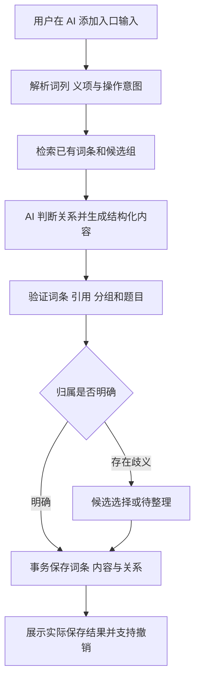

# AI 添加与自动归组

版本：`v0.4` · 日期：2026-11-03 · 状态：添加与撤销行为已确认，采用本机检索、存储和手机直连 API

对应已确认需求：[U08、U09、U16](index.md#已确认需求)。本文件是添加、归组和额外词推荐的详细行为维护位置；API 预设与调用控制由[专门模块](api-presets.md)维护。

## 用户期望

在 AI 添加入口说出自己分不清的词，即可得到有内容的词组。以后发现新词，继续输入，系统能够利用已有词库判断应放在哪个组，减少手动整理。

### 场景一：首次添加

输入：

> linear 和 liner，我总是搞混。

建议结果：

- 查找是否已有相关词条和词组。
- 如果没有相应组，建立以形似辨析为目的的词组。
- 生成简短释义、词性、字母差异说明、典型例句和适量练习材料。
- 保存后显示“已创建词组”，可以直接开始学习、编辑或撤销。

在专门的“AI 添加”入口中，输入 `linear, liner` 这样的简短词列也应可用，不强求用户填写完整命令。

手机端应保存输入草稿，支持中文说明与英文词混输；输入法正在组词时不误提交。添加完成后由后端返回实际保存结果，前端按[接口边界](frontend-backend-boundary.md)呈现。

### 场景二：以后补词

输入：

> 又遇到 linen，也容易跟刚才那几个混。

建议结果：

- 根据用户提到的上下文和已有组进行匹配。
- 在归属明确时，加入对应形似组，并补充新成员与已有成员的区别。
- 显示“已加入 linear / liner 所在词组”，展示简短归组理由。
- 保留原词条、用户笔记和已有学习进度；新增词及新增辨析关系从各自的实际学习状态开始。

这里的 `linen` 是说明连续添加流程的例子。没有用户提供的混淆关系时，词形相似只能形成候选，不能自动证明归组一定正确。

### 场景三：重复添加

再次输入 `linear / liner` 时，定位已有组或提示已经存在；可以继续学习或补充例句。重复请求不增加同样的词条、成员关系或重复练习。

### 场景四：归组纠正

用户说“这个不要放在那个组里”“把它也加到另一个组”时，修改对应关系并保留词条。将这次纠正保存为可撤销的归组偏好，下一次推荐同样关系时参考它。

## 归组的判断依据

每个组都需要有可解释的主题或辨析目的。成员关系至少区分：

| 关系 | 判断依据 | 不能直接推出的结论 |
| --- | --- | --- |
| 形似 | 拼写编辑距离、字母位置、可见结构，以及用户实际混淆 | 同前缀的所有单词都应进入同一组 |
| 近义 | 具体义项接近、存在值得训练的用法差异 | 任何句子里都可以互换 |
| 构词相关 | 已确认的词根、派生或词族关系 | 外形相近就必然有共同词源 |
| 音似 | 音标或发音信息，以及用户选择 | 拼写相近就一定读音相近 |
| 个人易混 | 用户明确说明或练习中发生的混淆 | 对所有学习者都有相同难度 |

归组依据优先考虑当前用户的明确表达和既有组目的。词典关系、字符串相似度和 AI 判断用于补充，保留来源区别。

一个词可以参与多个组。例如 `linear` 与 `liner` 的形似关系，并不妨碍它参与另一个词义辨析组。基础词条共享，组内说明和特定辨析能力分别保存。

## 默认自动化建议

| 情况 | 建议动作 |
| --- | --- |
| 用户明确说放入某个已有组 | 直接执行可逆添加，并显示实际结果 |
| 已存在同一词列或明确等价的组 | 优先复用，避免重复建组 |
| 检索找到一个明确匹配的组，关系与组目的相符 | 自动加入，解释原因并提供撤销 |
| 没有适合的组，用户明确输入了一组易混词 | 自动创建新组 |
| 只有一个孤立单词，暂无可靠关系 | 保存为可独立学习的词条；归组标为待整理，给出候选关系或由用户继续补充 |
| 两个已有组都同样合理，或词义无法确定 | 展示少量候选及原因，让用户选择；允许同时归入 |
| 用户输入疑似拼错的词 | 保留原输入，给出可能的拼写，不静默替换成另一个词 |
| 推荐了用户未提到的额外词 | 用户选择后才加入；需要 API 时由用户主动触发，加入后可以撤销 |

这里的“明确匹配”需要检索结果、关系一致性及实测归组质量支持，不能只取模型自行输出的一个置信度数字。自动入组阈值与候选数属于后续设计和验证内容。

本功能的常规成功路径是添加后可立即使用；不要求每次生成都经过逐字段审批。内容来源显示为 AI 生成，用户可以修正；资料有冲突、题目有歧义时，应明确表现出来。

## 额外词推荐与加入

用户输入词后的自动归组继续保留；对本次未提到的额外词，已明确采用“推荐后点击加入”。自动分析 AI 也遵循这项选择。

1. 候选可以来自本地已有关系、已保存的推荐，或一次已发起生成任务附带的结果。查看候选本身不发起新的 API 请求。
2. 主动寻找更多推荐属于单独可调用能力，用户发起后使用绑定的 API 预设。
3. 用户选择想加入的词。已有完整内容时直接复用；需要生成释义或辨析时，明确由这次操作触发对应 API 调用。后端提供是否需要调用和所用预设，具体呈现由 Claude 决定。
4. 完成后显示实际新增、复用与归组结果，提供撤销。未选中的候选保持推荐状态，不自动生成全部内容或递归扩词。
5. 撤销回退本次新增关系和相应实体，保留已有引用及真实学习记录。撤销加入不代表服务商会退回已经发生的调用费用。

取消、重复提交和迟到结果遵循下方任务规则。该流程不要求用户对每个释义逐项审批；是否发起新的 API 请求和是否接受额外词由用户决定。

## 技术实现方向

1. **规范化与保留原文**：统一用于匹配的输入形式，同时保留原始拼写、大小写和用户说明。词形变化与不同义项不随意合并。
2. **先检索再判断**：从本地词库找精确匹配、相似词和相关组；把候选组的目的、成员及必要义项交给模型。优先利用本地文本检索和字符串相似度；词库规模和效果确有需要时再增加向量检索。
3. **受约束的结构化输出**：让模型返回拟新增词条、现有组 ID、关系类型、解释和内容。已有组只能引用本次候选中真实存在的 ID。
4. **业务校验**：检查重复成员、未知 ID、无效关系、缺失词项、明显冲突及题目答案结构。字符串格式合法不等于语言内容已被证实。
5. **原子保存**：一次操作的词条、内容与分组关系一起落库；部分失败时不留下空组或悬空引用。学习历史使用稳定 ID 独立保存。
6. **可追溯结果**：展示真正写入的变化。用 `operation_id` 关联一次添加及其撤销，不把聊天中的“已添加”当作数据库写入凭证。

这些逻辑统一由后端承担。前端负责输入、候选选择与结果展示，接口不暴露供应商响应结构，具体职责见[前后端边界](frontend-backend-boundary.md)。

已有词条和候选组从本机检索，模型判断由手机直接请求所选 API；保存与撤销在本机执行。离线时可保存输入草稿、进行手动整理，将需要模型的操作保留为待处理，既有词库与学习不受等待影响，见[离线能力](implementation-plan.md#离线能力)。

已有组过大时，建议创建更聚焦的关联组或展示子集；仅因某个新词同时关联两个组，不自动把两个完整组永久合并。

## 生成什么内容

| 内容 | 首轮建议 |
| --- | --- |
| 词条 | 原词、规范词形、词性、当前相关义项、简短中英文解释 |
| 词组 | 可编辑标题、关系类型、辨析目的、成员 |
| 差异 | 一句话区别、词形差异、语境和搭配限制 |
| 例句 | 自然且能显示差异的句子；合成例句标记为生成 |
| 练习 | 少量可回答且可判定的练习；允许多个合理答案或标记歧义 |
| 元数据 | 内容来源、实际 API 预设及版本、生成模型、生成时间、内容版本、归组原因 |

词源、音标、考试级别、词频和权威来源都需要可靠数据，不作为模型必须“填满”的字段。词源助记若只是记忆联想，应直接称作助记。

## 词源与助记

按 U27 扩展现有“补充讲解”，为单个稳定义项保存中文讲解、英英释义、词根词缀、词源说明、助记故事、用法和例句。用户参考图提供功能方向；其中的词源解释不作为已核实资料直接导入。

- 语言学构词、历史词源与记忆联想分字段保存。没有可靠把握的词源可以留空或注明不确定；AI 内容不显示为已获词典核验，不编造参考来源。
- 生成使用 `EXPLANATION` 绑定和统一任务；保存有版本和来源，重新生成可撤销。原义项、用户笔记与真实作答保留。
- 分析 AI 可依据实际薄弱目标调用已登记的 `explain_sense`；自动讲解由 AI 调整中的能力锁控制，调用规则见[API 方案](api-presets.md#调用由用户控制)。阅读或生成助记不计为掌握，也不直接调整 FSRS。
- 练习生成读取与当前义项一致的已保存讲解，优先换语境检验用法；助记故事不作为历史事实或标准答案。义项被改动后旧讲解标为待更新，避免继续当作当前练习依据。
- 词族只形成可解释的候选；用户点击后复用现有 `AcceptRecommendations`，有内容可离线加入。词族不会自动塞进原有形似组，也不会递归扩词。
- 离线查看、进程恢复、重复请求、取消与关闭后的迟到结果、备份恢复共用原有机制。撤销讲解隐藏其词族候选，但保留之后主动加入的词和实际学习历史。

权威类型、兼容和前端接入口见[类型化讲解接口](../backend/explanations.md)。

同义词差异常受语境影响。AI 不能为了做成单选题而制造绝对化规则；对可以替换的词应说明替换后的语气或搭配变化。

AI 短文理解、造句与改写使用这些已保存的义项与辨析目的，按用户训练需求生成。训练内容与评分规则统一见[手机学习方案](mobile-learning.md#ai-训练与内容变化)；首次添加时不必一次生成所有后续题型。

## 批量导入与按需生成

文件导入仅接收[专属数据包](native-format.md)，以下行为均基于本软件格式。自然语言添加仍可接受用户输入的一组词，不另外建立第三方文件兼容流程。

| 操作 | 建议行为 |
| --- | --- |
| 导入专属词库内容包 | 校验版本、实体和依赖，预览新增、重复、冲突与无效记录，再提交选定内容 |
| 已有完整资料 | 保留用户资料和来源，按需补足差异或练习，避免无意义地重新生成全部内容 |
| 包内只有尚未补全的词条 | 可以先保存，再由用户为准备学习的部分发起补全；也可主动选择批量生成 |
| 导入已有分组 | 保留明确分组关系并检查重复；歧义进入待处理，不把同名组直接全部合并 |
| 用户要求 AI 整理大量已存词条 | 分批检索候选与归组，记录批次进度、失败项和变更；支持暂停或取消及恢复 |
| 加入今日学习 | 作为独立操作控制新学量，规则见[手机学习流程](mobile-learning.md#一次手机学习) |
| 恢复完整个人备份 | 按[恢复规则](native-format.md#导入与恢复行为)保存原有内容与历史，不自动重新生成或调用 API |

批量导入本身不发起模型请求。主动批量生成时应能看到数量、当前进度和已有用量，失败重试只处理必要部分。预设、调用范围和用量规则见 [API 预设方案](api-presets.md#调用由用户控制)。

导入批次与生成任务各有身份；单个批次可包含多项明确结果。暂停或进程结束后保留已经完成的内容，恢复时检查实际状态。对一次小型添加使用原子保存，大批量任务采用可核对的分批提交，避免把一万条导入或模型请求维持在一个长事务里。

输入资料与返回内容都保留来源标识。归组和解释的质量未确认时记录相应状态，不把“已经导入”自动显示成“已经学过”或“已经核对”。

## 与记忆记录的关系

- 新增一个组的成员不代表已经学会该词。
- 同一基础词条被多个组引用，不复制成多份独立词条。
- 添加关系时，新建必要的辨析学习项目；不一次生成所有词对和所有题型的组合。
- AI 改写说明或补充例句，不清空已经发生的学习记录。
- 撤销添加仅回退对应操作；已被后续学习或其他组引用的实体需要保留引用一致性。
- 纠正错误题目时，可标记受影响的作答记录，使它不继续作为正常正确率或个性化拟合依据。

## 重复操作与失败处理

- 连续点击或网络重试复用同一请求身份，避免重复创建。
- 任务未提交保存时，取消成功后迟到结果不自动写入。若保存先于取消完成，返回真实的“已完成”状态，并按规则提供撤销。
- 等待生成期间，用户仍可编辑其他词组和完成复习。
- 生成过程中已有组被用户修改时，保存前检查版本，重新匹配必要部分。
- 超时、限流、空白结果、输出截断、格式错误分别显示可理解的状态，保留输入以便重试。
- 内容展示按文本或受限格式渲染；导入资料和模型输出不作为可执行脚本。
- 输入草稿、任务身份、已提交结果和可恢复进度持久化保存。切后台、锁屏和系统结束进程不等于用户取消；重新打开后读取任务真实状态。
- Android 后台执行受系统约束，展示排队、等待网络、执行、完成或失败等可知状态；不承诺锁屏后一定持续运行或准时完成。平台依据见[Android 补充调研](../research/android-and-integration.md#后台生成与中断恢复)。
- 取消和应用内去重不保证服务商终止计费。发生网络超时而供应商结果未知时，避免无上限自动重试，保留可理解的任务状态与已知用量。

重复提交、取消与保存竞态、任务恢复属于后端职责；前端可以通过统一的任务接口观察和操作，不从加载动画推测实际任务进展。

## 后续验收场景

这些是实现后的验收方向，本轮尚未执行软件测试。

1. 空词库输入 `linear / liner`，产生一个包含两个词的可学习组。
2. 已有对应组时再次输入，复用已有实体。
3. 用户明确补充 `linen` 到刚才的组，新增成员和区别说明，历史保持完整。
4. 只共享常见前缀而缺乏组内关系的词，不因粗糙规则被大量并入。
5. 一个词合理属于两个组时，可以保留双重归属。
6. 一词多义导致歧义时，能选择义项或候选组。
7. 连续提交、失败重试、取消后返回，不产生重复或意外写入。
8. 撤销和手动纠正后，词条、组关系、题目与历史引用一致。
9. 导出后在空资料库恢复，仍能知道词属于哪些组及其归组理由。
10. 专属数据包导入后可单独学习孤立词、选择部分生成及逐步加入计划；重复恢复任务不会重做已完成批次。
11. 手机输入法确认、切后台、进程恢复及生成完成附近的取消，都能保留正确草稿和实际任务结果。
12. 查看推荐不产生新请求，用户选词后按需要使用对应预设，未选择的词不被自动加入。
13. 撤销推荐加入后，本次变化被回退，原有分组和后来发生的真实学习记录仍保持一致。
