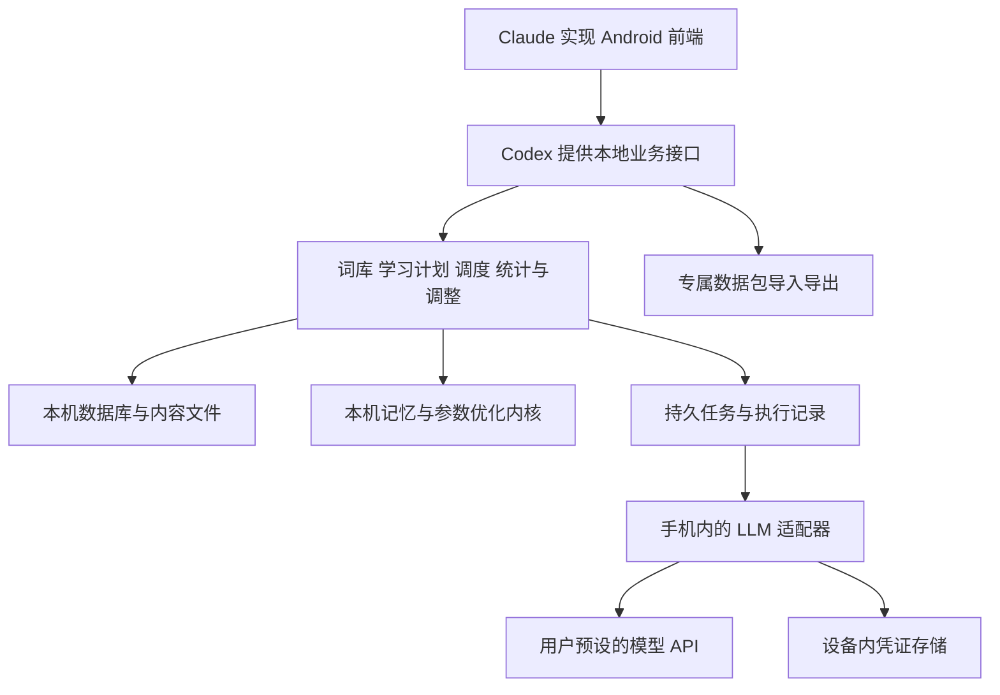

# 本机架构与实施方案

版本：`v0.4` · 日期：2026-11-03 · 状态：本机核心及 Android 集成已实现，验证范围见[记录](../backend/validation.md)

首版采用 Android 本地存储、离线学习和手机直接调用 LLM API，暂不做云同步。Codex 提供随应用打包的本机业务核心，Claude 实现前端；详细职责以[前后端边界](frontend-backend-boundary.md)为准。

本文维护技术组合、实施顺序与验证要求；学习、调用和数据恢复规则分别由对应产品模块维护。

## 本机数据流

前端通过本地调用获得数据和业务状态。LLM 返回的内容、调整方案及应用结果先由后端校验并持久化，再成为可查询状态。页面、后台任务与模型响应共用同一套数据与操作身份。

用户请求分析或生成时，手机会将该任务所需的内容发送给选择的模型服务。无需自建业务服务器或云账号，首版也不建立同步协议。

## 已采用的技术组合

| 部分 | 实现 | 验证与入口 |
| --- | --- | --- |
| 本地业务接口与 Android 集成 | Kotlin 类型化命令、查询与 `Flow` 修订通知 | [契约](../backend/contract.md)、同源 schema 与样例 |
| 词库、历史、计划和任务存储 | Android Room；宿主 SQLite 测试平台 | 事务、迁移、重启与备份恢复已验证 |
| Android 持久任务 | WorkManager 唤醒，核心数据库领取与提交任务 | 系统任务与数据库去重共同验证 |
| API 与凭证 | OkHttp / Chat Completions 与原生 Responses；Keystore AES-GCM | [协议接入](../backend/api-protocols.md)、本地 HTTP、错误分支与模拟器凭证验证；真实供应商待验证 |
| 记忆调度与个人拟合 | `fsrs-rs`，JNI，调度/拟合/评估共用 Rust 内核 | 发布源码、版本和许可已核对；双 ABI 构建与 x86_64 模拟器执行 |
| 前端消费方式 | Claude 的原生 Compose + `android/sdk-codex` 门面 | 本地 Maven 构件接入，真实核心集成测试 |
| 可携带数据 | 版本化 `.wordprism` ZIP 容器及模块 schema | [参考包](../backend/packages/README.md)、迁移与完整恢复 |

上述为本次实际采用的实现，具体版本与依赖核验集中维护在[构建与接入](../backend/running.md)。Android 官方分层、持久化和任务依据见[补充调研](../research/android-and-integration.md)。技术落地不改变已确认的产品范围。

## 模块边界

以下名称表示实际模块职责，不为每张表单独建模块。宿主 SQLite 实现在 `platform-jvm`，生成器在 `contract-fixtures`。

| 模块职责 | 对外提供 | 不暴露给界面的内部细节 |
| --- | --- | --- |
| `core-contract` | 稳定 ID、数据类型、能力描述、请求结果、错误和任务状态 | 数据库表、供应商原始响应 |
| `core-engine` | 词库操作、学习日与会话、判分、计划、总览、配置变更与撤销 | SQL、模型请求拼装与算法内部表示 |
| `platform-android` | 数据持久化、凭证、文件流、联网适配、持久任务 | Android 资源与生命周期处理的实现细节 |
| `memory-core` | 调度、历史回放、参数拟合、候选评估 | 原生桥接及具体内核类型 |
| 前端测试数据 | 与契约一致的样例状态和测试替身 | 真实凭证及用户资料 |

Codex 负责本地 SDK 和必要的算法桥接，Claude 负责界面及调用集成。即使前端采用另一种语言，存储、判分、调度与自动分析规则仍由同一核心执行。

## 本地任务与一致性

持久数据至少覆盖词条义项与关系、学习目标、题目版本、作答、会话、学习日、策略版本、任务尝试、分析快照、变更记录、API 预设和功能绑定。实体 ID 与实际事件时间稳定，不以页面标题或内存对象代替身份。

需要统一实现的操作包括：

1. 提交答案时，一致地保存作答、调度变化和会话进度；重复提交返回已有结果。
2. 结束学习日时，先保存日状态与有效数据位置，再建立一次自动分析任务；每日次数由持久记录控制。
3. 执行 AI 调整时，核对快照、当前配置、对应任务的调用授权和预算，原子保存变更及生效结果；自动任务同时检查自动开关，手动任务按用户本次操作执行。
4. 取消和关闭时，使排队任务失效，并在迟到结果提交前再次检查。API 用量可继续记录，失效任务不得修改学习策略。
5. 完整恢复时，在暂存资料库检查后切换，保持引用、版本和历史可解释。

每日结束、手动分析、跨日延迟与自动名额的详细规则统一见[每日分析与手动控制](adaptive-learning.md#每日分析与手动控制)。任务 ID、数据库约束和 Android 唯一任务协同去重；仅靠 WorkManager 名称不足以保证全部业务一致性。

参数拟合与历史回放在可取消的后台计算中执行，避免阻塞输入和答题。设置合理的数据规模、计算时长和并行度，具体值通过目标设备实测确定。每日 AI 分析不意味着每天都必须重新拟合全部参数。

## 离线能力

| 场景 | 断网时的行为 |
| --- | --- |
| 查看或手动整理词库 | 使用本机数据，保存编辑与归组变化 |
| 学习与复习 | 使用已保存内容、可本地构造的客观练习与当前策略，正常记录作答和调度 |
| 总览与计划 | 本地计算统计和适用的学习计划，展示已有分析及其截止时间 |
| 已有短文与造句任务 | 内容可继续使用；开放表达先保存，新的 AI 反馈等待联网 |
| 新的 AI 添加、讲解、短文或分析 | 保存输入和任务状态，按已授权规则等待网络；不显示虚假的生成结果 |
| 专属导入导出 | 对设备上可访问的文件正常处理；系统文件提供方是否需要联网单独反映 |
| 参数拟合与候选评估 | 所需数据和内核已在本机时可执行，不新增模型 API 请求 |

基础离线题和已保存的 AI 题仍需遵循[题目与评分规则](mobile-learning.md#作答与评分)。无法客观判断的开放回答不因断网而自动判对或判错。

## 算法内核的选型条件

用户需要本机运行与参数微调，选型必须同时考虑调度和优化；仅有调度函数的库不能独自完成全部需求。

当前采用实际发布的 `fsrs` crate，经源码核对后使用调度、个人参数计算与历史评估接口。发布版本、VCS 身份、BSD-3-Clause 及传递依赖许可见[源码与许可](../backend/running.md#源码与许可)。已构建两个 Android ABI，并在 API 35 x86_64 模拟器执行 JNI 调度和拟合。早期候选调研见 [R51](../research/sources.md#r51)、[R52](../research/sources.md#r52)、[R53](../research/sources.md#r53)。

选型和后续升级须继续满足：

- 固定发布版本或明确提交，核对该版本实际包含的能力；默认分支内容不能直接当成相同版本号的发布包。
- 通过 Android 原生桥接构建目标 ABI，执行调度与拟合样例；验证取消、失败隔离和资源消耗。
- 调度、拟合与回放共用兼容的模型版本和参数定义，核对参考输出及时间表示；避免在 Kotlin 与原生模块维护互不一致的两套算法。
- 真实学习数据不足时保留有效初始参数，训练与质量目标仍可调整；需要优化时使用原始记录及明确评分口径。
- 验证拟合数据组织的内存增长，避免照抄大规模研究模拟的默认配置。

若后续真机验证发现性能不能满足要求，应在本机执行边界内优化或替换实现。当前拟合有样本数、时长与并行限制，见[运行边界](../backend/running.md#运行边界)；尚无目标规模或长期质量证据。

## 实施顺序与交付

下列阶段表示实施依赖顺序，不因阶段结束自动暂停。五阶段能力均已实现并完成相应本地验证，实际执行记录与外部证据限制见[验证记录](../backend/validation.md)。

| 顺序 | 后端工作与交付 | 对应验证 |
| --- | --- | --- |
| 1 | 固定本地接口、初始 schema、算法版本和 Android 绑定，提供 Claude 可消费的样例 | 内核最小构建、契约样例和数值参考检查 |
| 2 | 词库、义项关系、稳定学习目标、作答与基础调度，专属包基础恢复 | 本地学习流程、重复提交、断网与重启、恢复一致性 |
| 3 | API 多预设、手机直连、AI 添加与推荐选择、变化练习及反馈 | 选定真实协议的成功和失败场景，取消、预设变更、来源记录 |
| 4 | 统一总览、30 分钟内的质量优先计划、每日分析、个人拟合、变更与回退 | 每日去重、手动与自动交错、关闭和迟到结果、保留新作答的撤销 |
| 5 | 扩展完整备份到全部模块，和 Claude 前端完成 Android 联调 | 功能增减迁移、完整真实流程、键盘与中断恢复、目标设备表现 |

每阶段由实现方完成必要自检和测试，不另设独立评审流程。样例和模拟服务用于开发，真实 API、Android 行为和学习效果分别验证。

最终交付包括本地库、正式类型与样例、包格式及参考包、前端适配器、测试、构建说明和已生成的 Android 安装包。最低版本、目标 ABI、前端绑定及协议范围已固定；真实供应商、物理手机、目标规模性能和发行签名仍按证据边界记录，不把未执行的验证记为完成。
