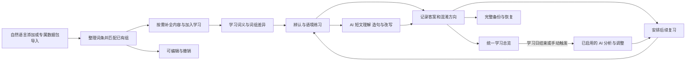

# 产品方向方案

版本：`v0.4` · 日期：2026-11-03 · 状态：本机运行、每日分析与个人目标已确认，具体技术实现待固定

用户已明确的需求见[方案索引](index.md)。Android 优先、个人易混词库、混合训练、专属格式、AI 自动调整及 API 预设均已纳入；首版采用本地存储、离线学习和手机直连 API，暂不做云同步。具体技术栈与接口仍需通过实施准备固定。

## 产品定位

建立一个会持续积累个人易混词的学习工具：随手告诉 AI 哪些词分不清，系统整理成可比较、可练习的词组；之后根据真实错误和记忆情况安排复习。

核心学习目标是：离开对照页面、换一个句子、过一段时间后，仍然能认对和用对这些词。

Android 手机是主要使用端，背单词是核心任务。短文理解与写作练习使用同一套个人易混词，帮助用户在新语境中认对、用对。暂按英语优先、中文辅助解释设计。

混合训练已经确认，包含辨认、回忆、AI 短文理解、造句及改写。成熟机制作为可个性化的起点，结合个人数据调整训练与记忆参数；用延迟后、新语境下的表现检验价值。具体行为见[手机学习与 AI 训练](mobile-learning.md)。

学习总览既供用户浏览，也为 AI 提供统一的个人数据。自动分析每天学习结束后执行一次，支持手动触发与关闭；AI 可以实际改变明日学习量、重点词、训练比例和记忆算法参数，保留可查看、可回退的记录。详细规则见[学习总览与 AI 自动调整](adaptive-learning.md)。

用户每天大致愿意投入半小时以内，记忆质量优先。计划按个人表现调整词数、题型和时长，允许减少新学或提前结束；预算与质量指标由[个人目标与动态预算](adaptive-learning.md#个人目标与动态预算)统一维护。

实施时 Codex 负责本机业务核心，Claude 负责前端。双方职责见[前后端边界](frontend-backend-boundary.md)，技术组合与实施顺序见[本机方案](implementation-plan.md)。视觉风格、组件与页面布局由 Claude 设计。

## 核心流程

典型使用过程：

1. 在“AI 添加”中输入“`linear` 和 `liner` 总是搞混”。
2. 系统匹配已有词库，建立或补充相应词组，并生成差异说明和练习材料。
3. 用户先看最关键的差别，再完成几道与该差别有关的题。
4. 系统记录答案、提示和实际选择，以可观察的证据区分词义遗忘、词形混淆与用法问题。
5. 后续用变化语境复习；根据训练强度，加入 AI 短文理解和造句任务。
6. 后续加入相似单词时，沿用已有词条与分组关系，逐步完善个人词库。
7. 用户在总览查看实际表现；当日学习结束后，已启用的 AI 分析读取同一数据，调整后续安排，也可手动触发。用户能查看修改和撤销。

## 词组如何组织

| 类型 | 例子 | 重点展示 | 主要训练方向 |
| --- | --- | --- | --- |
| 形似 | `linear / liner`、`adapt / adopt` | 字母差异、词性、核心义 | 精确辨认、词义对应、必要时拼写 |
| 近义 | `say / tell`、`job / work` | 搭配、句型、语体、适用语境 | 语境选择、替换判断 |
| 同根或构词相近 | `economic / economical` | 构词关系及实际用法差异 | 语境与搭配辨析 |
| 音似或同音 | `principal / principle` | 发音与拼写、意义对应关系 | 听辨与拼写；优先级待定 |
| 用户自定义 | 用户自己容易串记的词 | 原始上下文与个人备注 | 按实际混淆原因出题 |

词组是可以重叠的集合。同一个词可以参与多个组，而释义按具体词性和义项组织。`bank` 的金融义与河岸义不能仅因拼写相同就共用同一个“已经掌握”结论。

建议把一次对照展示的核心词控制在少量成员，初始可试 2–5 个；大组支持按关系聚焦。该数量是待验证的产品起点，不是研究给出的普适阈值。

自动建组、后续补词、多组归属和纠正的详细行为统一见 [AI 添加方案](ai-intake.md)，不在此重复定义。

## 学习与记忆

建议采用“先建立基本认识，再做差异辨析，之后间隔复习”的学习流程。对于本来认识、只是经常混淆的词，可直接进入辨析。

形似词与近义词采用不同的讲解模板和题目模板：

- **对照讲解**：每组先给一句区别、突出差异的词形、简短义项、典型搭配和必要例句。
- **主动辨认**：根据明确含义或语境选择词，作答前隐藏解释和差异高亮。
- **主动回忆**：逐步加入无选项填空或拼写，避免始终依靠选项识别。
- **纠错反馈**：说明正确答案的依据，以及用户选错的那个词为什么不适用于当前条件。
- **迁移复习**：在新句子、新词序和无提示条件下再次检查，降低对固定题目的记忆依赖。

近义词题允许“两个都可以，但语气不同”等情况。可客观判定的题按明确答案评分；开放式造句采用 AI 辅助反馈，记录与调度的规则见[作答与评分](mobile-learning.md#作答与评分)。混合训练的具体比例由用户设置与已启用的个性化策略共同决定。

### 记忆算法建议

采用现有 FSRS 实现作为复习时间安排的起点候选，保存个人混淆记录，并通过 AI 调整与数据拟合持续个性化：

| 部分 | 回答的问题 | 当前建议 |
| --- | --- | --- |
| FSRS 调度 | 这项学习内容什么时候需要再复习？ | 保存原始作答记录和算法状态；初期使用所选版本的默认参数 |
| 混淆记录 | 用户常把哪个词当成另一个词？ | 记录题目目标、实际选择、题型、提示使用及时间 |
| 练习选择 | 这一轮应重点训练什么？ | 在合理复习负担内，优先安排已发生混淆的关系 |
| AI 自动调整 | 当前计划和参数是否适合这个用户？ | 读取统一总览与明细，实际调整策略、调用优化器并记录效果与回退 |

单词基础认识与某个词对的辨析能力分别记录。一个词出现在多个组中时，共享基础词条；不同辨析关系保留各自表现。

调度单位应稳定，不随 AI 改写一道例句就产生新的全部复习历史，也不预先为每个词组生成全部排列组合的卡片。

错误或忘记属于失败；“困难但答对”属于成功。作答耗时可以用于分析，但不直接把慢答判成遗忘。算法版本、评分映射、短期练习与正式复习的边界在后续方案中固定。

研究支持间隔练习和主动回忆；对于本产品特定的词组调度方式，仍需要实际使用数据验证。依据与适用范围见[调研报告](../research/landscape.md#学习证据及产品影响)。

AI 最高业务权限、算法参数的拟合与评估、配置生效和撤销规则统一见[自动调整方案](adaptive-learning.md)，避免出现独立于调度引擎的第二套改期逻辑。

## LLM 接口与内容

AI 负责整理、归组、解释、生成变化语境、评价开放表达，以及分析个人数据和调整策略。已保存内容可以直接使用，基础学习统计由后端计算。

支持多个 API 预设，并按功能独立选择。预设保存连接、模型和有效请求配置；一次任务记录实际使用的预设版本。具体服务协议的支持范围在技术轮确定，前端呈现由 Claude 设计，详细规则见 [API 预设方案](api-presets.md)。

内容分为可编辑的词条、组间差异和练习材料，保存生成来源与内容版本。AI 生成的解释显示为生成内容；只有实际使用的词典或语料才能成为来源，不能由模型编造引用。

本地保留原始内容和修改记录。生成失败可以重试或手动补充；用户进行既有复习时，不必等待新内容生成。

日常复习复用已有题目池；学习分析可补充新内容。额外词推荐后点击加入，相关请求由用户决定并可撤销加入。调用控制、重试和费用记录统一见[调用规则](api-presets.md#调用由用户控制)。

API 凭证与学习内容分别保存在本机，普通导出不包含凭证。手机内的后端适配器直接调用所选模型服务，处理响应解析和业务校验；前端通过统一本地接口使用结果。离线时继续使用已保存内容，需要新模型结果的操作按[离线能力](implementation-plan.md#离线能力)处理。

## 数据携带与恢复

导入导出仅支持本软件专属格式。保留专属数据包的批量导入与完整备份恢复，移除第三方格式适配。格式暂定为版本化的 `.wordprism` 容器，正式定义见[专属格式方案](native-format.md)。

完整备份需要保存词条与关系、内容、实际作答、算法和计划状态、学习总览的必要来源、AI 调整历史及非敏感 API 预设配置。凭证单独管理。以后增减功能时通过模块版本、迁移和未知数据保留处理兼容性。

导入、AI 内容补全和加入学习计划可分别执行；导入本身不触发 API。完整恢复与追加内容包采用不同的数据处理，重复导入保持稳定 ID，失败保留原资料库。详细规则由[恢复方案](native-format.md#导入与恢复行为)维护。

## 首版候选范围

### 建议作为完整首版

- 自然语言添加、自动新建或补充已有词组。
- 词组对照页面、词形差异高亮、简短释义、搭配及例句。
- 手动编辑、搜索、标签、归组纠正、撤销。
- 形似辨认与语境选择为主的练习，按目标加入主动回忆。
- 可试用的 AI 短文理解、造句与改写，记录目标词表现和反馈来源。
- 可个性化的 FSRS 候选调度、今日复习与近期易混关系。
- 专属数据包批量导入、完整备份恢复及版本演进。
- 统一学习总览，供用户查看、AI 读取并查询明细。
- 每天学习结束后一次、支持手动和关闭的 AI 分析，实际调整计划与参数，记录依据、版本及撤销结果。
- 半小时以内、质量优先的动态学习预算，按实际表现安排数量、训练方式与时长。
- API 多预设、按功能绑定、调用控制、失败重试、取消和用量统计。
- 本地存储与离线学习，本机调度和参数拟合，手机直接调用 API。

### 根据讨论提高优先级

| 功能 | 何时优先 |
| --- | --- |
| 发音播放与听辨 | 音似混淆是重要问题；需选定音频来源 |
| 短文取词、剪贴板快捷入口 | 阅读时遇词随手收集是主要场景 |
| 考试日期、词书与词频过滤 | 以明确考试和完整词表为目标 |
| 更长阅读材料与段落写作 | 短文、单句造句和改写的实际使用表明有延伸价值 |

云同步已明确暂不实现，当前通过专属备份迁移与恢复。多人共享、社区词库、排行榜、复杂游戏系统、大型关系图、文档 OCR 和完整阅读器暂列后续候选。是否扩大范围取决于讨论结果。

## 交付方向与运行边界

首版以可在 Android 手机上安装、学习和导入导出的应用为目标。原生 Android 是当前候选，跨端框架可在技术轮比较；Windows 桌面应用不再作为首版默认方向。

前端与后端通过本地契约分工。后端业务核心随应用打包，维护数据、调度、分析任务和 API 适配；原生或其他前端框架消费相应接口及桥接。运行边界已经固定，具体库版本和绑定方式见[本机实施方案](implementation-plan.md)。

Android 生命周期、后台调度和文件访问会直接影响实际体验，研究依据见[补充调研](../research/android-and-integration.md)。本轮不将框架支持列表视为已经完成的真机能力。

## 如何判断做成了

产品效果与技术正确性分别验证。

| 层面 | 初始验证方向 |
| --- | --- |
| 添加效率 | 从一句自然语言到可学习词组；多次补词保持分组连贯 |
| 辨析效果 | 相隔一段时间、换新语境后，目标混淆是否减少；短文理解与主动输出分别观察 |
| 自动归组质量 | 正确归入、误归入、漏掉已有组分别统计；看用户需要纠正的比例 |
| 负担与质量 | 半小时以内预算下的实际投入、延迟后记忆与新语境表现；新学量是否造成不可持续的积压 |
| 内容质量 | 释义、拼写、词性和例句正确；客观题不存在未处理的多个合理答案 |
| 数据可靠性 | 重复导入、取消生成、撤销、重启、完整备份恢复后状态一致 |
| 个性化调整 | AI 能真正改计划与参数，依据可核对；观察后续效果，回退保留真实进度 |
| 版本兼容 | 功能增减后专属格式可迁移或明确报告不兼容，保留可保留的历史数据 |
| 调用控制 | 不同功能使用所选预设；查看数据不触发 API，自动调用遵循已启用范围 |
| 接口可靠性 | 对选定真实服务验证成功、超时、限流、截断和格式错误；前后端按契约完成真实联调 |

可先用一小批人工核对的词组和用户实际易混词试用。开发中的模拟数据只验证流程，不用于宣称真实学习效果或接口性能。

## 当前讨论入口

前三轮方向与本次答复已记录到[方案索引](index.md#方向决策状态)。本轮落实已确认的本机运行、每日分析和质量目标；具体技术绑定、版本与验证安排见[当前方案与剩余实施项](index.md#当前方案与剩余实施项)。
